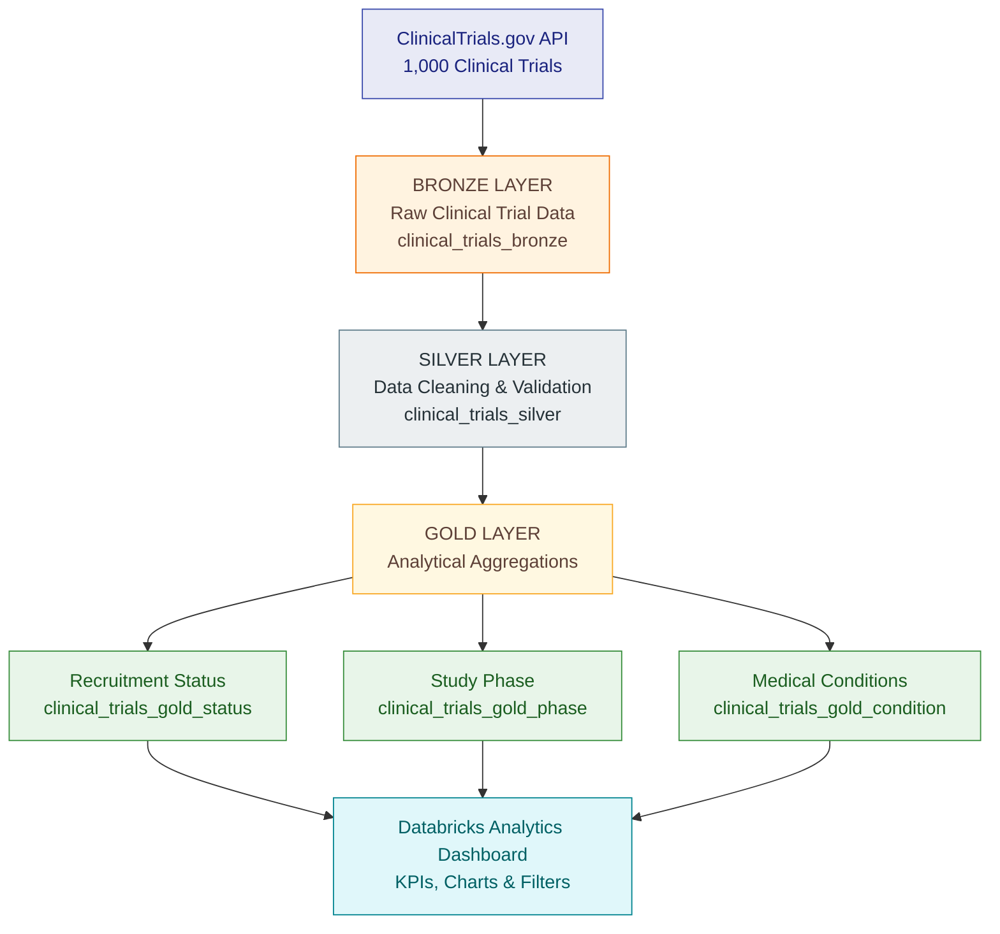

# Clinical Trial Data Pipeline | Databricks

## Project Overview

This project demonstrates an end-to-end clinical trial
data engineering and analytics workflow.

## Technologies Used

- Databricks
- Python
- SQL
- Apache Spark
- Delta Lake
- Medallion Architecture

## Key Performance Indicators

| Metric | Result |
|---|---:|
| Total Clinical Trials | 1,000 |
| Total Reported Enrollment | 779,828 |
| Average Enrollment per Trial | Approximately 790 |
## Clinical Trial Analytics Dashboard

This interactive Databricks dashboard analyzes 1,000 clinical trials retrieved from ClinicalTrials.gov.

The dashboard includes:
- Total clinical trials: 1,000
- Total reported enrollment: 779,828
- Average enrollment per trial: approximately 790
- Recruitment status distribution
- Clinical trial phases
- Medical condition analysis

### Dashboard Preview

### Data Architecture

This project uses the Medallion Architecture to organize clinical trial data into three layers: Bronze, Silver, and Gold.

The architecture separates raw data ingestion, data cleaning, and analytical processing to support reliable reporting and data analysis.

### Bronze Layer: Raw Data Ingestion

The Bronze layer stores raw clinical trial records retrieved from the ClinicalTrials.gov API.

The data includes study identifiers, recruitment status, enrollment information, study phases, and medical conditions.

Purpose: Preserve source data before transformation.

### Silver Layer: Data Cleaning and Transformation

The Silver layer transforms raw clinical trial records into structured datasets suitable for analysis.

Processing includes:

* Extracting relevant clinical trial attributes.
* Organizing data into structured columns.
* Preparing recruitment and enrollment information.
* Checking data completeness and consistency.
* Storing processed records in a Delta table.

Purpose: Create a consistent dataset that can support downstream analytics.

### Gold Layer: Analytical Aggregation

The Gold layer prepares clinical trial data for reporting and visualization.

The analytical datasets support:

* Clinical trial counts by recruitment status.
* Enrollment analysis.
* Study phase distributions.
* Medical condition comparisons.
* Clinical trial trends over time.

Purpose: Transform processed clinical trial data into information that stakeholders can use to understand research activity.

### Data Flow

ClinicalTrials.gov API → Bronze Layer → Silver Layer → Gold Layer → Databricks AI/BI Dashboard

This layered approach demonstrates how clinical research data can move from publicly available records to structured analytical datasets and interactive visualizations.

## Data Pipeline Architecture

This project implements a three-layer Medallion Architecture using Databricks, Apache Spark, SQL, and Delta Lake.

### Business Value

Pharmaceutical companies, biotechnology firms, and Contract Research Organizations (CROs) manage large volumes of clinical trial data across multiple therapeutic areas, development phases, and research sites. Transforming this information into accessible insights can help organizations make more informed operational and strategic decisions.

This project demonstrates how Databricks can transform publicly available clinical trial records into structured, analysis-ready datasets and interactive dashboards.

### Potential Business Applications

**1. Clinical Trial Recruitment Monitoring**

Analyze recruitment status across clinical trials to identify enrollment trends, understand recruitment activity, and highlight studies that may warrant further investigation.

**2. Clinical Development Portfolio Analysis**

Compare clinical trials across Phase 1, Phase 2, Phase 3, and Phase 4 to understand the distribution of research activity throughout the drug development lifecycle.

**3. Therapeutic Area Insights**

Examine clinical trial activity across medical conditions to identify areas of research concentration and explore trends in clinical development.

**4. Data Quality and Standardization**

Apply structured data processing and validation to improve consistency, identify missing information, and prepare clinical trial datasets for downstream analytics.

**5. Scalable Analytics Architecture**

Demonstrate how Databricks, Delta Lake, and Medallion Architecture can organize raw clinical trial information into reusable datasets that support reporting and visualization.

### Connecting Technology to Healthcare

My background in clinical research inspired this project. Having worked with clinical trial data, patient recruitment, and research operations, I wanted to explore how modern data engineering technologies could address challenges commonly encountered in clinical development.

By combining healthcare domain knowledge with Databricks, SQL, Apache Spark, and Delta Lake, this project demonstrates how technical solutions can translate complex research information into meaningful insights for clinical and business stakeholders.

Note: This is a portfolio demonstration using publicly available clinical trial data. The business applications described are potential use cases rather than validated operational outcomes.
